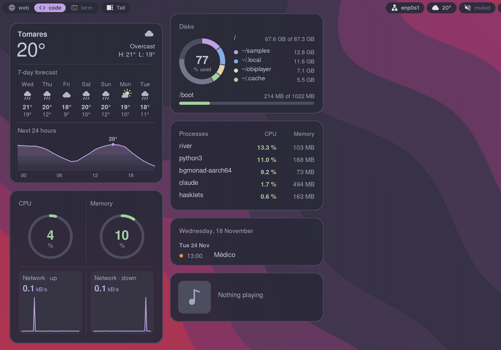
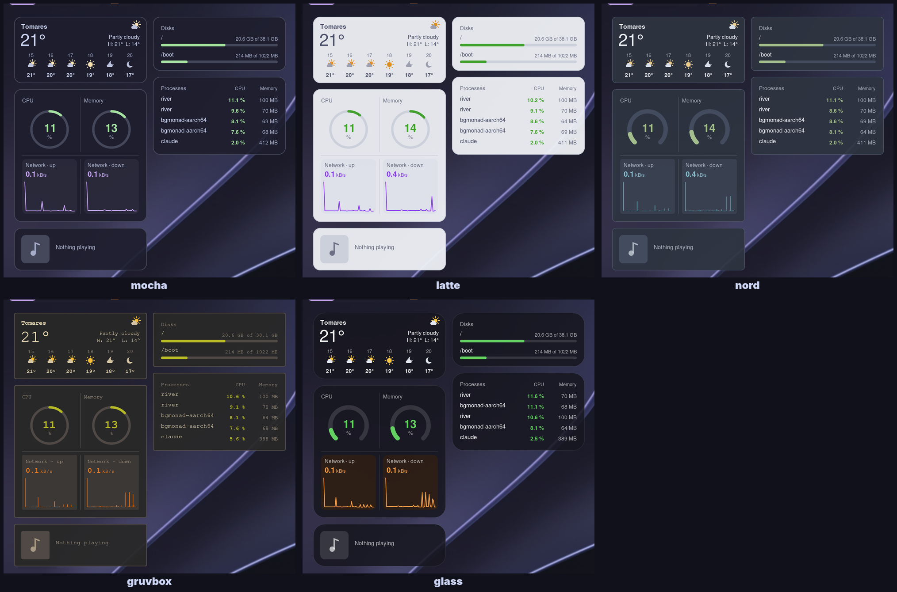

# hasklets

Desktop widgets for Wayland, written in Haskell with GTK 4 and cairo. They
sit on the desktop, above the wallpaper and below the windows, on any
compositor with wlr-layer-shell; made to go with
[rivermonad](https://github.com/prietus/rivermonad) and
[waymobar](https://github.com/prietus/waymobar).



* **Weather**: current conditions, high and low, and the next six hours,
  from [Open-Meteo](https://open-meteo.com) (no API key) or from your own
  wtr server (Apple's WeatherKit)
* **Weather, with forecast** (`forecast`, hidden by default): the same, plus
  the week ahead and the temperature of the next 24 hours as a curve
* **CPU, memory and network**: two ring gauges and a minute of upload and
  download history, read from `/proc`
* **Media player**: cover art, title, artist, progress and previous /
  play-pause / next buttons for any MPRIS player, over D-Bus
* **Disks**: a ring for the disk your home directory is on, split into the
  four folders or files that take the most space in it (measured with `du`
  every ten minutes), and a bar with the used and total space of every
  other real filesystem
* **Processes**: the ones using the most CPU, with their memory
* **Calendar**: the events of the next two weeks from iCloud, Google, any
  CalDAV server or an iCal address
* five themes: dark, light, Nord, Gruvbox and a translucent glass look
* configured with a JSON file that is reloaded when it changes, or from a
  settings window (right-click any widget)
* gi-gtk4 and [gtk4-layer-shell](https://github.com/wmww/gtk4-layer-shell);
  everything is drawn with cairo and pango

## Build

```sh
sudo pacman -S gtk4 gtk4-layer-shell gobject-introspection curl   # plus ghc and cabal-install
cd hasklets
cabal install --installdir ~/.local/bin
```

The first build compiles the GTK bindings and takes a while. `curl` is used
at run time for the weather, the calendars and cover art served over HTTP.

Start it from your rivermonad config:

```haskell
startupHook = spawnOnce "hasklets"
```

On other compositors, run `hasklets` from their autostart.

## Configuration

`hasklets` reads `~/.config/hasklets/config.json`, creating it with the
defaults the first time. The file is watched: save it and the widgets
rearrange themselves, without restarting and without losing the history of
the charts. If it does not parse, the error goes to stderr and the previous
configuration is kept.

```json
{
  "theme": "mocha",
  "scale": 1,
  "corner": "top-left",
  "margin": 24,
  "gap": 14,
  "columns": [["weather","system","mpris"],["disks","processes"]],
  "weather": {"latitude":40.42,"longitude":-3.70,"name":"Madrid","provider":"open-meteo"},
  "processes": {"rows":5}
}
```

| Field | Default | |
|---|---|---|
| `theme` | `"mocha"` | see [Themes](#themes) |
| `scale` | `1` | size of the widgets, 0.5 to 3: `1.25` makes them a quarter bigger |
| `corner` | `"top-left"` | or `"top-right"`, `"bottom-left"`, `"bottom-right"` |
| `margin` | `24` | distance from the screen edges, in logical pixels |
| `gap` | `14` | space between widgets |
| `columns` | see above | columns from left to right, each a list of `weather`, `forecast`, `system`, `mpris`, `disks`, `processes`, `calendar`; a widget that is not listed is hidden |
| `positions` | `{}` | widgets dragged out of their column, as `{"disks": [640, 300]}`: the distance from the two edges of the corner, in logical pixels |
| `weather.name` | `"Madrid"` | title of the weather widget |
| `weather.latitude`, `weather.longitude` | `40.42`, `-3.70` | forecast location; sent to the weather provider |
| `weather.provider` | `"open-meteo"` | or `"wtr"`: a wtr server (WeatherKit) at `weather.url`, with the token of `~/.config/wtr/api_token`; it has no hourly forecast, so the widget shows the next six days instead of the next six hours |
| `weather.rain` | `true` | rain falls over the weather cards while it rains; `false` keeps them still |
| `processes.rows` | `5` | processes shown, 1 to 10 |

Missing fields take their default.

### Themes



| `theme` | |
|---|---|
| `mocha` | Catppuccin Mocha: dark and flat, thin ring gauges (the default) |
| `latte` | Catppuccin Latte: the light counterpart |
| `nord` | Nord colors, squarer cards, arc gauges and bar charts |
| `gruvbox` | Gruvbox colors, nearly square corners, monospace text, bar charts |
| `glass` | translucent dark cards with large corners and arc gauges |

A theme is a record in `app/Theme.hs` with the colors, the corner radius,
the font and the style of gauges and charts; adding one is adding a record
to the `themes` list.

The themes use the [Inter](https://rsms.me/inter/) font (`inter-font` on
Arch), except the one in monospace; without it they are drawn in the
system's default font.

### Calendar

The calendar widget is hidden until it is added to a column. Its accounts
are not in `config.json` but in `~/.config/hasklets/accounts.json`, a file
only its owner can read, because they hold passwords; add them from the
settings window, or by hand:

```json
{"calendars": [
  {"provider": "icloud", "user": "me@icloud.com", "password": "abcd-efgh-ijkl-mnop"},
  {"provider": "google", "user": "me@gmail.com", "password": "abcdefghijklmnop"},
  {"provider": "caldav", "url": "https://cloud.example.org/remote.php/dav/", "user": "me", "password": "..."},
  {"provider": "ics", "url": "https://example.org/calendar.ics"}
]}
```

| `provider` | |
|---|---|
| `icloud` | every calendar of the account, with an [app-specific password](https://support.apple.com/102654) |
| `google` | the main calendar of the account, with an [app password](https://support.google.com/accounts/answer/185833); if Google rejects it, use the calendar's "secret address in iCal format" as an `ics` account |
| `caldav` | every calendar of an account on any CalDAV server (Nextcloud, Fastmail, Radicale...) |
| `ics` | a read-only iCal address; no user or password |

Passwords reach `curl` through its standard input, never on its command
line. Events are fetched every ten minutes. Repeating events are expanded
for daily, weekly, monthly and yearly rules; the rarer parts of a rule
(`BYMONTHDAY`, `BYSETPOS`...) are ignored.

### Placing widgets by hand

Drag a widget with the left button to put it anywhere on the screen. It
leaves its column, and on the way it sticks to the sides of the other
widgets, so they are easy to line up. The place is saved in `positions`; the
settings window has a button that puts every dragged widget back in its
column. This needs a compositor with layer-shell.

### Settings window

`hasklets --config`, or a right-click on any widget, opens a window that
edits the same file: move widgets between columns or hide them, choose the
theme, the size, the corner and the spacing, add calendar accounts, look up the coordinates of a place by name (through
Open-Meteo's geocoding service) and set the number of processes. *Apply*
saves, and the running widgets pick the change up.

To have it float on rivermonad:

```haskell
myManageHook = composeOne
  [ appId =? "dev.hasklets.Settings" -?> doCenterFloat ]
```

## Development

Each widget is a module in `app/` with a loop that fetches its data on its
own thread and a `Render ()` that draws it; `Main.hs` puts them in the
window according to the configuration, `Draw.hs` has the shared drawing
primitives (card, gauge, sparkline, text) and `Theme.hs` the themes they
are styled with.
